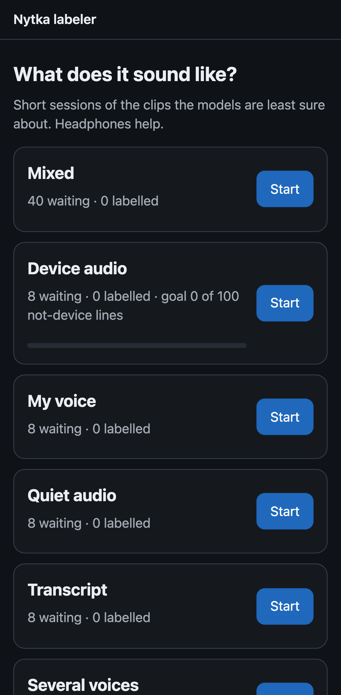
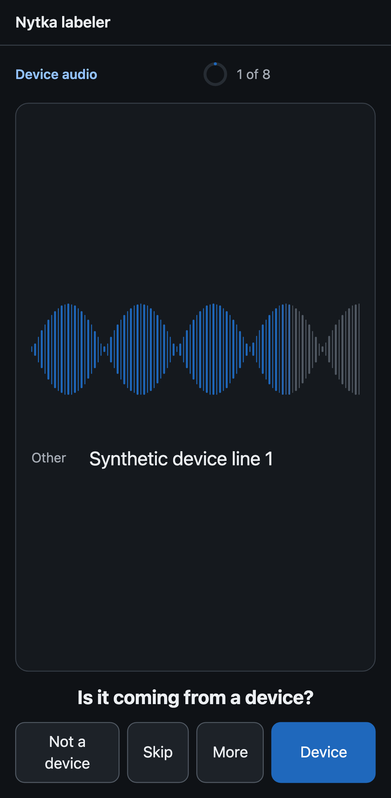
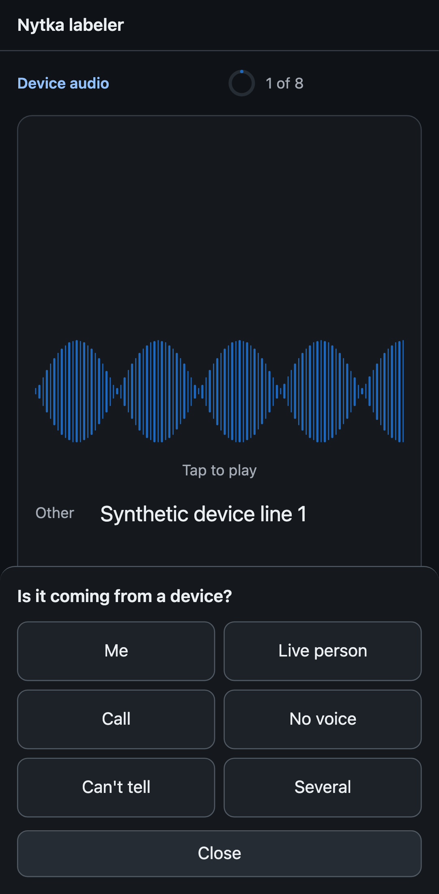
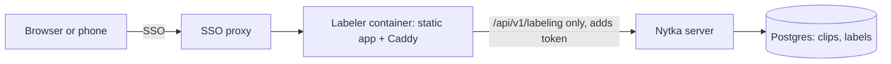

# Nytka labeler

> Hear a short clip from your Nytka recordings and tap what kind of audio it is, so Nytka's models learn from your ear.

<p align="center">
  
  
  
</p>

## Why

[Nytka](https://github.com/nytka-app/server) is a self-hosted second brain: a pendant records the day, the server
transcribes it and pulls out conversations, people and tasks. Some of what the pendant hears is not a person in the
room: a TV, a laptop, the far side of a call on speaker. Some lines are too quiet to trust, and some voices are
the owner's own but scored as someone else's. My ear tells these apart in a second; the models need labelled
examples to learn the same. Earlier rounds of labelling on throwaway pages already moved real settings, and one
such page lost every label to a button bug. This app makes labelling a habit with a test behind every button.

## What it does

- A vertical feed of about 30 clips, one per screen, each playing as it arrives. The server picks the clips its
  models are least sure about, plus a random slice so rates stay honest; "Mixed" interleaves tasks in short runs.
- One fixed yes/no question per task: swipe right for yes, left for no, up to skip, down to go back, hold for every
  answer and the optional details (device type, kind of sound, quality flags, language, a corrected transcript).
  A button rail does the same for anyone who doesn't swipe; arrow keys and 1–7 on a desktop.
- The model's guess stays hidden until after the answer, so it never steers the ear. Every answer can be undone for
  4 seconds. The feed ends at the day's goal with what the session moved, and nothing after it.
- Answers wait in the browser until the server confirms them, so a reload or a dropped connection loses nothing.
  The feed pauses when the tab is hidden and never plays in the background.
- Lines marked "me" teach the voiceprint only after a separate confirmation, because that cannot be undone.
- Clips and labels stay on the Nytka server. This repository holds code only; its tests use synthetic tones.

The taxonomy, what each label is for, how the server picks clips, and the privacy rules: [DESIGN.md](DESIGN.md).
The API both clients use: [docs/api.md](docs/api.md). The Android client:
[nytka-app/labeler-android](https://github.com/nytka-app/labeler-android).

## Quick start

Run it against the fake API (synthetic clips, nothing leaves your machine):

```bash
npm ci
npm run dev        # open http://127.0.0.1:8787/
```

Run the image in front of a Nytka server that has the labeling routes:

```bash
docker run -p 8080:8080 \
  -e NYTKA_UPSTREAM=http://nytka:8080 \
  -e NYTKA_LABELING_TOKEN="$(cat token-file)" \
  ghcr.io/nytka-app/labeler:latest
```

Put an SSO proxy in front of it: the container adds the token itself, so whoever reaches it can label.

## How it works



The page is plain JavaScript with no build step. Caddy serves it and forwards only `/api/v1/labeling/*`, replacing
any token the browser sends with its own and dropping the proxy's cookies. Every other server route answers 404
from the container.

## License

Apache-2.0. See [LICENSE](LICENSE).
